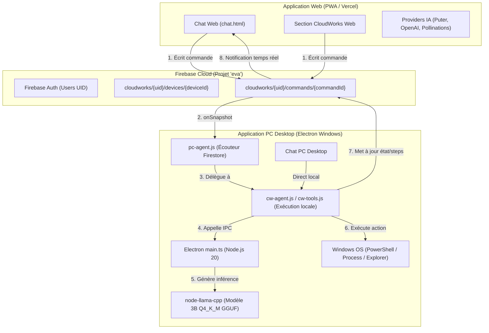

# RAPPORT D'ARCHITECTURE COMPLÈTE — PROJET E.V.A

---

## 1. VUE D'ENSEMBLE

E.V.A est un assistant virtuel hybride. Il propose à la fois une interface conversationnelle (chat) et une capacité d'action directe sur le système d'exploitation Windows (appelée **CloudWorks**).



---

## 2. DÉTAIL DES COMPOSANTS

### A. L'Application Navigateur Web (`EVA_V4_fixed_v4`)
- **Technologies** : HTML5, CSS3, JavaScript ES5/ES6 classique, Firebase v9/v10 compat.
- **Rôle** : Interface utilisateur universelle.
- **Fonctionnement du chat** :
  - Quand l'utilisateur écrit dans le chat, le message est traité par `messages.js` et envoyé au provider actif via `chat-handler.js`.
  - Si le message demande une action sur le PC (ex: *"Ouvre YouTube sur mon PC"*), EVA doit générer une commande CloudWorks enregistrée dans Firestore `cloudworks/{uid}/commands`.

### B. L'Application PC Electron (`eva-pc`)
- **Technologies** : Electron 31, TypeScript compilé, Vite, `node-llama-cpp` v3, `systeminformation`, `node-pty`.
- **Rôle** : Assistant bureau résident, capable d'agir directement sur Windows et d'héberger le LLM local.
- **Moteur LLM Local** :
  - Fichier modèle : `EVA-PC-Agentic-3B-Q4_K_M-v5.gguf` (environ 1.9 Go, basé sur Qwen 2.5 3B).
  - Gestion du cycle de vie dans `main.ts` :
    - `startLLM()` : Initialise `node-llama-cpp`, charge le modèle avec un contexte de 8192 tokens.
    - `llm:chat` IPC : Reçoit les messages, crée une `LlamaChatSession`, réutilise la séquence de contexte via `sessionId` pour le cache KV, et renvoie la réponse au format OpenAI-like `{ choices: [{ message: { role, content } }] }`.

### C. Le Moteur Agentique CloudWorks (`cw-agent.js`, `cw-tools.js`)
- **Modèle ReAct** :
  - **Pensée (`<thought>`)** : Le modèle décompose la demande, explique ce qu'il comprend et pourquoi il choisit une action.
  - **Action (`<tool_call>`)** : Appel d'un outil avec ses arguments JSON.
  - **Observation** : Le résultat de l'outil est renvoyé au modèle.
  - **Finalisation** : Le modèle émet `[TACHE_TERMINEE]` avec un compte-rendu.
- **Outils disponibles dans `cw-tools.js`** :
  - `app_resolve(query)` : Recherche d'une application dans le registre Windows et les raccourcis.
  - `app_launch(target, args)` : Lancement d'un `.exe` ou ouverture d'une URL HTTPS dans le navigateur par défaut via `cmd /c start "" "url"`.
  - `file_list`, `file_read`, `file_create`, `folder_create` : Gestion de fichiers.
  - `screenshot_take` : Capture d'écran locale.
  - `system_status` : Informations CPU, RAM, OS.

---

## 3. LES FLUX DE COMMUNICATION

### Flux 1 : Tâche lancée depuis le Web vers le PC
1. L'utilisateur clique sur "Exécuter" ou demande dans le chat web : *"Ouvre YouTube"*.
2. Le navigateur crée un document dans `cloudworks/{uid}/commands/{cmdId}` :
   ```json
   {
     "id": "cmd_12345",
     "type": "agentic_task",
     "status": "pending",
     "step": "En attente du PC...",
     "payload": { "prompt": "Ouvre YouTube" },
     "createdAt": "2026-11-24T12:00:00Z"
   }
   ```
3. L'application PC, connectée avec le même compte `uid`, a un écouteur actif `onSnapshot` dans `pc-agent.js`.
4. Le PC détecte le document `pending`, le passe à `running`, et instancie `CWAgent`.
5. `CWAgent` appelle le LLM local via IPC `window.eva.system.llmChat()`.
6. Le LLM local produit l'action -> `cw-tools.js` exécute la commande sur Windows.
7. `pc-agent.js` met à jour le document Firestore à chaque étape :
   `step: "Exécution : app_launch..."` puis `status: "done"`.
8. Le navigateur web reçoit la mise à jour via son propre écouteur et affiche *"Tâche terminée ✓"*.

### Flux 2 : Tâche lancée directement sur l'application PC
1. L'utilisateur utilise la section "Tâche IA libre" dans l'app PC.
2. `cloudworks.js` appelle `_cwRunAgenticTask(prompt)`.
3. Il crée le document Firestore pour garder l'historique et alimenter la carte de suivi UI.
4. Il instancie `window.CWAgent(uid, taskId)`.
5. Le LLM local tourne en boucle ReAct et exécute les outils sur la machine locale.
6. Le résultat est affiché dans la carte de l'interface PC.
